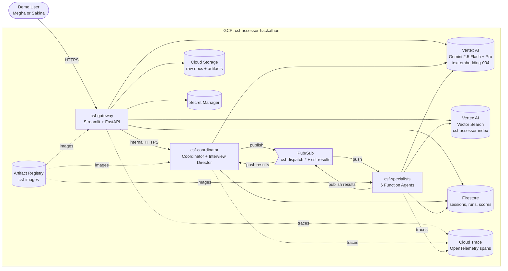
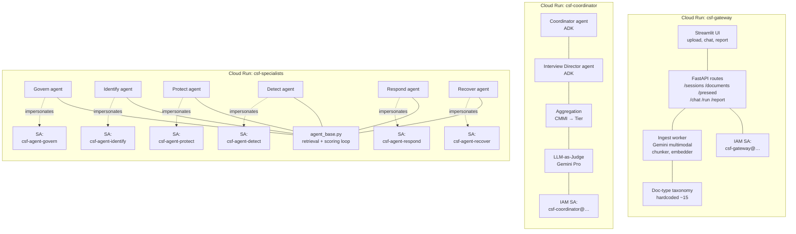
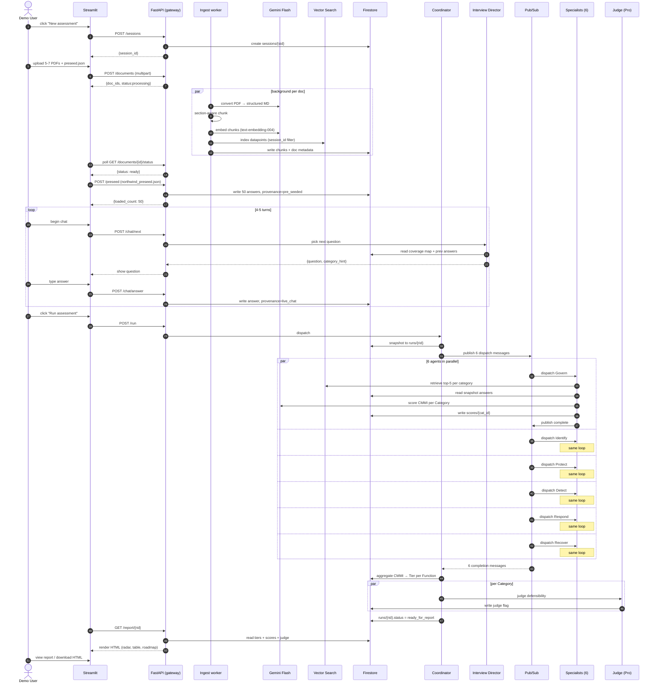
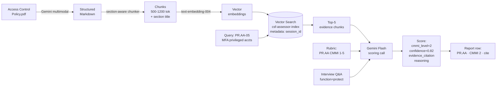

# CSF Assessor Fleet — Architecture

**Companion doc:** `csf_assessor_hackathon_plan.md` (schedule) + `~/.claude/plans/now-lets-plan-the-mossy-glacier.md` (system plan) + `docs/lld.md` (low-level design).

All Mermaid diagrams below render natively on GitHub.

---

## 1. System context (who talks to what)



---

## 2. Deployment topology (three Cloud Run services + per-agent identity)



**Ingress rules:**
- `csf-gateway` — public (session URL is the boundary)
- `csf-coordinator` — internal only, invoked from gateway
- `csf-specialists` — internal only, Pub/Sub-triggered

**Per-agent identity:** the specialists container has permission to impersonate 6 dedicated service accounts. Every Firestore read and Vertex AI call an agent makes is authenticated as its own SA, and Cloud Trace records which identity ran each span. Preserves the "one IAM identity per agent" Fortified track claim without paying 8× cold starts.

---

## 3. User journey (happy path)



---

## 4. Data flow (from a policy PDF to a CMMI score citation)



---

## 5. Fortified track components (where each lives)

```mermaid
flowchart LR
    subgraph "Ingest / gateway"
        F1[Agent Gateway<br/>FastAPI ingress]
    end

    subgraph "Coordinator"
        F2[Memory Bank<br/>runs/{rid} snapshot]
    end

    subgraph "Specialists"
        F3[Agent Identity<br/>per-agent SA impersonation]
        F4[Model Armor / DLP<br/>PII scrub before LLM]
    end

    subgraph "Cross-cutting"
        F5[Agent Registry<br/>Firestore on startup]
        F6[Agent Observability<br/>OTel → Cloud Trace]
    end
```

---

## 6. Environments + regions

| Item | Value |
|---|---|
| GCP project | `csf-assessor-hackathon` |
| Region | `us-central1` |
| Firestore mode | Native |
| Storage buckets | `csf-assessor-hackathon-raw-docs` (permanent), `csf-assessor-hackathon-artifacts` (30-day lifecycle) |
| Pub/Sub topics | `csf-dispatch-{govern,identify,protect,detect,respond,recover}` + `csf-results` |
| Artifact Registry | `csf-images` |
| Container image tags | `gcr.io/csf-assessor-hackathon/csf-images/{gateway,coordinator,specialists}:<git-sha>` |
| Traces | Cloud Trace (via `--trace_to_cloud` on `adk deploy cloud_run`) |
| Cost budget | $30 → $60 → $100 → $140 billing alerts already set |
