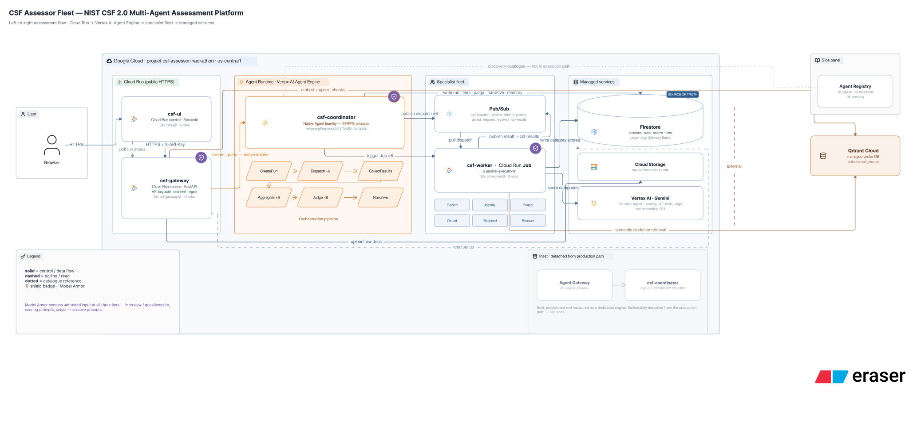
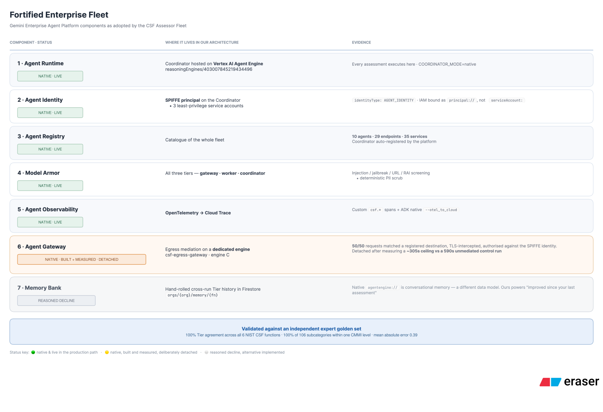

# CSF Assessor Fleet — Architecture

**Verified against live infrastructure on 2026-08-31.** Every resource identifier, revision and
role count below was read from the deployed system, not from a design document.

Project `csf-assessor-hackathon` · region `us-central1`.

---

## System



### Components

| Component | Type | Identity | Notes |
|---|---|---|---|
| `csf-ui` | Cloud Run **service** | `csf-ui@` · 5 roles | Streamlit; public; holds the gateway API key server-side |
| `csf-gateway` | Cloud Run **service** | `csf-gateway@` · 13 roles | FastAPI; API-key auth, rate limiting, ingest, Model Armor |
| `csf-coordinator` | Vertex AI **Agent Engine** | **SPIFFE agent identity** | `reasoningEngines/403007845219434496` |
| `csf-worker` | Cloud Run **Job** | `csf-worker@` · 9 roles | 6 parallel executions, one per CSF Function |
| Firestore | Native mode | — | **Source of truth** |
| Pub/Sub | 7 topics | — | `csf-dispatch-{6 functions}` + `csf-results` |
| Cloud Storage | 2 buckets | — | Raw evidence documents |
| Qdrant Cloud | **External SaaS** | API key | Vector store, collection `csf_chunks` |

`csf-worker` is a **Job**, not a service — it has no URL and no ingress. It is triggered per
Function and consumes its dispatch message from Pub/Sub.

### Request lifecycle

1. Browser → `csf-ui` over HTTPS
2. `csf-ui` → `csf-gateway` with `X-API-Key`
3. `POST /sessions/{sid}/run` mints a `run_id`, returns **immediately**, and starts a
   background task
4. That task invokes the Coordinator on Agent Engine via `stream_query`, passing
   `session=… functions=… run=…`. The `run=` is load-bearing: it makes the hosted run write
   the exact Firestore document the UI is already polling
5. The Coordinator publishes six dispatch messages and triggers six `csf-worker` Job executions
6. Each worker retrieves evidence from Qdrant, reads interview answers from Firestore, scores
   its Categories with Gemini, writes scores, and publishes completion to `csf-results`
7. The Coordinator collects completions, aggregates Tiers, runs the Judge, generates the
   narrative, and writes everything to Firestore
8. The UI polls `GET /sessions/{sid}/runs/{rid}/status`, which reads Firestore

Because Firestore is the source of truth, a dropped event stream does not fail a run — the
engine keeps executing server-side and status polling continues to report correctly.

### Coordinator pipeline

Composed as an ADK `SequentialAgent`:

```
CreateRun → Dispatch ×6 → CollectResults → Aggregate ×6 → Judge ×6 → Narrative
```

- **CreateRun** — writes `sessions/{sid}/runs/{rid}` with the evidence snapshot and rubric hashes
- **Dispatch** — publishes to `csf-dispatch-{function}` and triggers the worker Job
- **CollectResults** — polls `csf-results` for completions belonging to *this* run
- **Aggregate** — Category CMMI → Function Tier; writes the Memory Bank entry
- **Judge** — independent defensibility review per Category, on a second model
- **Narrative** — generated executive summary

### Models

| Purpose | Model |
|---|---|
| Document parsing, scoring, interview | `gemini-3.5-flash` |
| LLM-as-Judge, narrative | `gemini-3.7-flash` |
| Embeddings | `text-embedding-004` (768-dim) |

`GOOGLE_CLOUD_LOCATION=global` because Gemini 3.x is not served regionally on this project; the
Agent Engine resource is regional (`us-central1`). The two are independent — verified.

### Pipeline stages

**Ingest** — upload to Cloud Storage → parse (PDF via Gemini multimodal, DOCX via python-docx,
XLSX via openpyxl) → content-hash dedupe → section-aware chunking → embed → Qdrant + Firestore.
`.pptx` is not supported.

**Interview / Q&A** — a conversational ADK interview, or bulk extraction from a completed
questionnaire.

**Scoring** — six specialists, one per Function, each an ADK `LlmAgent` with a structured
output schema at `temperature=0.1`, scoring against a per-Function CMMI rubric.

**Aggregation → Judge → Narrative → Report** — Streamlit, HTML, Excel and PDF surfaces.

**Scope:** 6 Functions · 22 Categories · 106 Subcategories.

---

## Fortified components



Five components are native and live in the production path, one is native but deliberately
detached, and one is a reasoned decline. The reasoning for each is in the
[README's limitations section](../README.md#known-limitations-and-why).

### Security posture

- **Identity** — the Coordinator holds a SPIFFE agent identity with an auto-rotating 24h X.509
  certificate, IAM-bound as `principal://…` rather than `serviceAccount:`. The three Cloud Run
  workloads hold separate least-privilege service accounts (13 / 9 / 5 roles). The public UI is
  the least privileged and holds no vector-store credential
- **Input screening** — Model Armor at gateway, worker and coordinator, plus a deterministic
  PII scrub before every LLM call
- **Network** — both Cloud Run services are `--allow-unauthenticated`; enforcement is
  application-level API key plus per-instance rate limiting

---

## Related

- [Evaluation results](eval_results.md) · [Golden set](Golden%20Set.xlsx) · [Sample report](sample_report_northwind.pdf)
- [Architecture decisions](decisions.md) · [Tier vs CMMI](tier%20vs%20cmmi.md)
- `infra/verify_deployment.sh` — read-only verification of everything above
