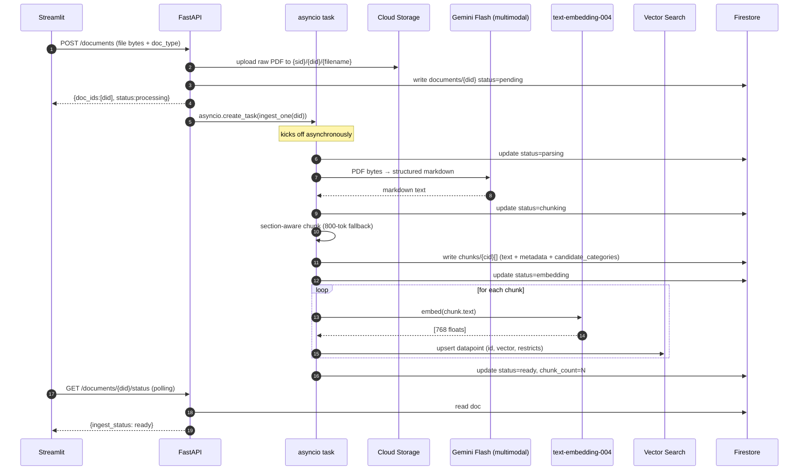
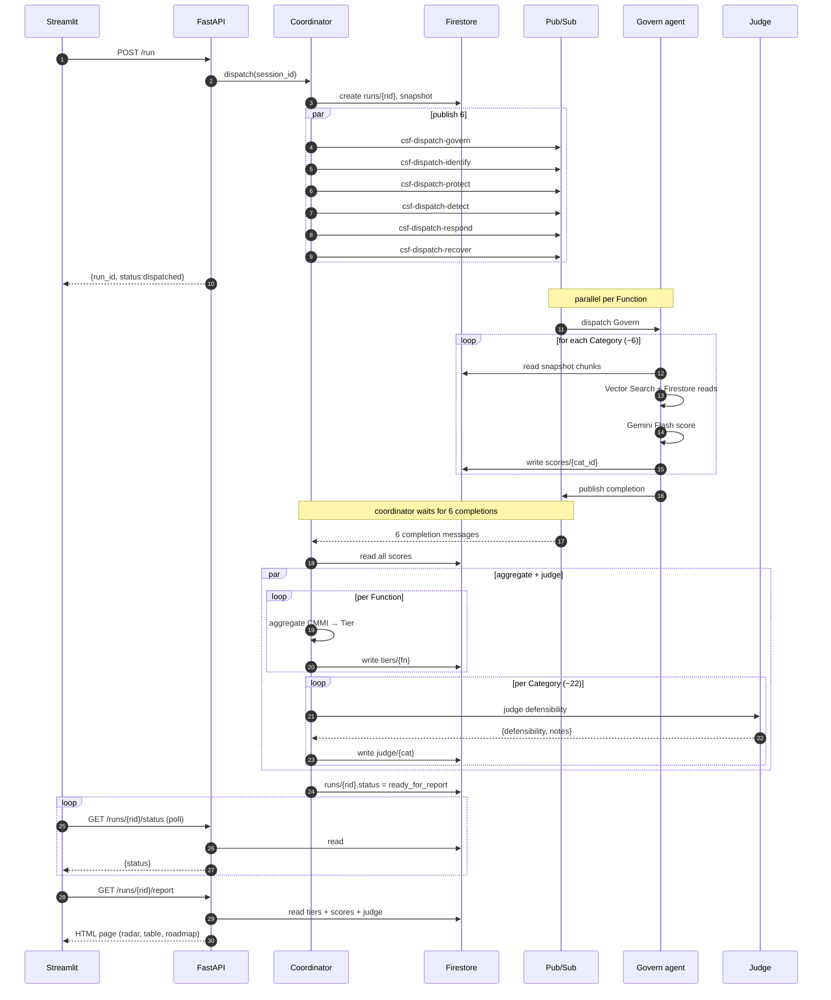

# CSF Assessor Fleet — Low-Level Design

Concrete schemas, contracts, and algorithms. Pair with [architecture.md](architecture.md) for the visual.

---

## 1. Firestore schema

```
sessions/{session_id}
├─ session_id: str (uuid)
├─ target_org: str = "Northwind Financial"
├─ created_at: timestamp
├─ status: enum {collecting_inputs, running, ready_for_report, complete}
├─ doc_ids: [str]
├─ preseed_loaded: bool
├─ chat_state: {questions_asked: int, done: bool}
├─ run_id: str | null
│
├─ documents/{doc_id}
│   ├─ doc_id: str (uuid)
│   ├─ filename: str
│   ├─ content_hash: str (sha256, for dedupe)
│   ├─ gcs_uri: str  ("gs://…-raw-docs/{session_id}/{doc_id}/{filename}")
│   ├─ doc_type: str (from hardcoded taxonomy, see §7)
│   ├─ page_count: int
│   ├─ chunk_count: int
│   ├─ uploaded_at: timestamp
│   ├─ ingest_status: enum {pending, parsing, chunking, embedding, ready, failed}
│   ├─ failure_reason: str | null
│   │
│   └─ chunks/{chunk_id}
│       ├─ chunk_id: str
│       ├─ text: str
│       ├─ section_title: str
│       ├─ page_start, page_end: int
│       ├─ chunk_index: int
│       ├─ token_count: int
│       ├─ vector_datapoint_id: str
│       └─ candidate_categories: [str]  (keyword-tagged at ingest)
│
├─ answers/{answer_id}
│   ├─ answer_id: str
│   ├─ question: str
│   ├─ answer: str
│   ├─ function: str  (govern, identify, ...)
│   ├─ category_hint: str  (e.g. "GV.OC-01")
│   ├─ provenance: enum {pre_seeded, live_chat, live_chat_generated}
│   ├─ asked_at: timestamp
│   └─ parent_question_id: str | null   (for depth-1 follow-ups)
│
└─ runs/{run_id}
    ├─ run_id: str (uuid)
    ├─ session_id: str
    ├─ dispatched_at: timestamp
    ├─ status: enum {dispatched, partial, ready_for_report, complete, failed}
    ├─ expected_agents: int = 6
    ├─ completed_agents: int
    ├─ snapshot: {doc_ids: [str], answer_ids: [str], rubric_version: str}
    │
    ├─ scores/{category_id}
    │   ├─ category_id: str  (e.g. "GV.OC")
    │   ├─ function: str
    │   ├─ cmmi_level: int (1-5)
    │   ├─ confidence: float (0-1)
    │   ├─ evidence_citations: [{doc_id, chunk_id, section, pages, snippet}]
    │   ├─ interview_evidence: [answer_id]
    │   ├─ reasoning: str
    │   ├─ scored_by_agent: str
    │   ├─ scored_at: timestamp
    │   └─ no_doc_evidence: bool
    │
    ├─ tiers/{function}
    │   ├─ function: str
    │   ├─ tier: int (1-4)
    │   ├─ avg_cmmi: float
    │   ├─ category_count: int
    │   └─ insufficient_evidence_count: int
    │
    └─ judge/{category_id}
        ├─ defensibility: enum {high, medium, low}
        ├─ judge_notes: str
        └─ judged_at: timestamp

registry/{agent_name}  (top-level, not per-session)
├─ agent_name: str
├─ version: str (git sha)
├─ function: str | null
├─ categories: [str]
├─ iam_sa: str
├─ capabilities: [str]
├─ deployed_at: timestamp
└─ cloud_run_url: str
```

**Indexes needed:**
- Composite on `answers`: `(function ASC, provenance ASC)`
- Composite on `scores`: `(function ASC, cmmi_level ASC)`
- Composite on `chunks`: array-contains on `candidate_categories`

---

## 2. Vector Search index

**Index:** `csf-assessor-index` (single shared, streaming updates)

**Datapoint schema:**
```
{
  datapoint_id: "{session_id}::{doc_id}::{chunk_id}",
  feature_vector: [768 floats],   // text-embedding-004
  restricts: [
    {namespace: "session_id", allow_list: [<session_id>]},
    {namespace: "function_hint", allow_list: [<function_names>]}
  ],
  crowding_tag: doc_id            // limit results-per-doc at query time
}
```

**Query pattern:**
```python
neighbors = index_endpoint.find_neighbors(
    queries=[embed(query_text)],
    num_neighbors=5,
    filter=[
        Namespace(name="session_id", allow_tokens=[session_id])
    ],
    per_crowding_attribute_num_neighbors=2,   # max 2 hits per doc
)
```

---

## 3. Pub/Sub messages

**Topic:** `csf-dispatch-{function}` (one per Function, 6 total)

```json
// dispatch message (coordinator → specialist)
{
  "run_id": "uuid",
  "session_id": "uuid",
  "function": "govern",
  "category_ids": ["GV.OC", "GV.RM", "GV.RR", "GV.PO", "GV.OV", "GV.SC"],
  "rubric_version": "v2026.08.20",
  "snapshot_ref": "runs/{run_id}"
}
```

**Topic:** `csf-results` (shared, all specialists publish here)

```json
// completion message (specialist → coordinator)
{
  "run_id": "uuid",
  "function": "govern",
  "status": "complete",           // or "partial", "failed"
  "category_count": 6,
  "failed_ids": [],
  "duration_ms": 24300,
  "flash_calls": 6,
  "tokens_in": 12400,
  "tokens_out": 3200
}
```

---

## 4. REST API (gateway)

### Sessions
```
POST   /sessions                                    → {session_id}
GET    /sessions/{sid}                              → SessionState
DELETE /sessions/{sid}                              → 204  (future)
```

### Documents
```
POST   /sessions/{sid}/documents                    multipart, N files + doc_types
                                                    → {doc_ids: [str], status: "processing"}
GET    /sessions/{sid}/documents                    → [DocumentSummary]
GET    /sessions/{sid}/documents/{did}/status       → {ingest_status, progress_pct}
DELETE /sessions/{sid}/documents/{did}              → 204
```

### Pre-seed
```
POST   /sessions/{sid}/preseed                      body: JSON array (see Sakina's file shape below)
                                                    → {loaded_count}
```

### Chat
```
POST   /sessions/{sid}/chat/next                    → {question_id, question, category_hint} | {done: true}
POST   /sessions/{sid}/chat/answer                  body: {question_id, answer}
                                                    → {stored: true, next_available: bool}
POST   /sessions/{sid}/chat/finish                  → {done: true}   (early user opt-out)
```

### Run
```
POST   /sessions/{sid}/run                          → {run_id, status: "dispatched"}
GET    /sessions/{sid}/runs/{rid}/status            → {status, completed_agents, expected_agents}
GET    /sessions/{sid}/runs/{rid}/report            → HTML (rendered)  or JSON on ?format=json
GET    /sessions/{sid}/runs/{rid}/report/download   → text/html (self-contained file)
```

---

## 5. Pydantic models (`csf-gateway/app/schema.py`)

```python
from enum import Enum
from datetime import datetime
from pydantic import BaseModel, Field
from typing import Literal

class IngestStatus(str, Enum):
    pending    = "pending"
    parsing    = "parsing"
    chunking   = "chunking"
    embedding  = "embedding"
    ready      = "ready"
    failed     = "failed"

class DocType(str, Enum):
    access_control_policy    = "Access Control Policy"
    acceptable_use_policy    = "Acceptable Use Policy"
    incident_response_plan   = "Incident Response Plan"
    business_continuity_plan = "Business Continuity Plan"
    disaster_recovery_plan   = "Disaster Recovery Plan"
    data_classification      = "Data Classification Standard"
    vendor_risk_mgmt         = "Vendor Risk Management Policy"
    vuln_mgmt_standard       = "Vulnerability Management Standard"
    encryption_policy        = "Encryption Policy"
    email_policy             = "Email Policy"
    logging_monitoring       = "Logging & Monitoring Standard"
    change_management        = "Change Management Policy"
    asset_inventory          = "Asset Inventory"
    risk_register            = "Risk Register"
    other                    = "Other"

class Function(str, Enum):
    govern   = "govern"
    identify = "identify"
    protect  = "protect"
    detect   = "detect"
    respond  = "respond"
    recover  = "recover"

class Provenance(str, Enum):
    pre_seeded             = "pre_seeded"
    live_chat              = "live_chat"
    live_chat_generated    = "live_chat_generated"

# --- API DTOs ---

class SessionState(BaseModel):
    session_id: str
    target_org: str
    status: Literal["collecting_inputs", "running", "ready_for_report", "complete"]
    doc_ids: list[str]
    preseed_loaded: bool
    chat_state: "ChatState"
    run_id: str | None

class ChatState(BaseModel):
    questions_asked: int = 0
    done: bool = False

class DocumentSummary(BaseModel):
    doc_id: str
    filename: str
    doc_type: DocType
    page_count: int
    chunk_count: int
    ingest_status: IngestStatus
    failure_reason: str | None

class PreseedRecord(BaseModel):
    id: str
    question: str
    answer: str
    function: Function
    category_hint: str      # e.g. "GV.OC-01"
    provenance: Provenance = Provenance.pre_seeded
    importance: int = Field(2, ge=1, le=3)   # 1-3 weight for prioritization

class ChatQuestion(BaseModel):
    question_id: str
    question: str
    category_hint: str
    is_followup: bool = False
    parent_question_id: str | None = None

class ChatAnswerInput(BaseModel):
    question_id: str
    answer: str

# --- Agent I/O ---

class ScoreOutput(BaseModel):
    category_id: str        # e.g. "GV.OC"
    function: Function
    cmmi_level: int = Field(..., ge=1, le=5)
    confidence: float = Field(..., ge=0.0, le=1.0)
    evidence_citations: list["EvidenceCitation"]
    interview_evidence: list[str]  # answer_ids
    reasoning: str
    no_doc_evidence: bool = False

class EvidenceCitation(BaseModel):
    doc_id: str
    chunk_id: str
    doc_title: str
    section: str
    page_start: int
    page_end: int
    snippet: str            # 200-char preview

class TierResult(BaseModel):
    function: Function
    tier: int = Field(..., ge=1, le=4)
    avg_cmmi: float
    category_count: int
    insufficient_evidence_count: int

class JudgeResult(BaseModel):
    category_id: str
    defensibility: Literal["high", "medium", "low"]
    judge_notes: str
```

---

## 6. Specialist agent contract (`csf-specialists/agent_base.py`)

Every Function agent extends this. Behavior is identical; config differs.

```python
class SpecialistAgent:
    """
    One instance per Function. Reads its rubric + Categories from config,
    scores each Category from a snapshot, writes results to Firestore.
    """
    function: Function
    category_ids: list[str]
    rubric: dict[str, RubricLevels]   # category_id → 5 CMMI level descriptions
    system_prompt: str = SPECIALIST_SYSTEM_PROMPT

    def handle_dispatch(self, msg: DispatchMessage) -> None:
        run = firestore.get(f"runs/{msg.run_id}")
        for cat_id in self.category_ids:
            try:
                score = self.score_category(cat_id, run.snapshot)
                firestore.write(f"runs/{msg.run_id}/scores/{cat_id}", score)
            except Exception as e:
                observability.log_error(cat_id, e)
        self.publish_completion(msg.run_id)

    def score_category(self, cat_id: str, snapshot) -> ScoreOutput:
        # 1. Retrieve evidence chunks
        query = self.build_query(cat_id)                           # rubric + category name + keywords
        chunks = vector_search.query(
            embedding=embed(query),
            filter={"session_id": snapshot.session_id},
            top_k=5,
        )

        # 2. Retrieve interview answers
        answers = firestore.query(
            f"sessions/{snapshot.session_id}/answers",
            where=[("category_hint", "startswith", cat_id.split(".")[0])]  # match Function prefix
        )

        # 3. Score via one Gemini Flash call
        response = gemini_flash.generate(
            system_prompt=self.system_prompt,
            user_prompt=self.build_scoring_prompt(cat_id, chunks, answers, self.rubric[cat_id]),
            response_schema=ScoreOutput,
            temperature=0.1,
        )
        return response.parsed
```

**Config file (`csf-specialists/agents/govern.py`):**
```python
from csf_specialists.agent_base import SpecialistAgent
from csf_specialists.rubrics import load_rubric

govern_agent = SpecialistAgent(
    function=Function.govern,
    category_ids=["GV.OC", "GV.RM", "GV.RR", "GV.PO", "GV.OV", "GV.SC"],
    rubric=load_rubric("govern"),   # loads govern.yaml — Sakina-authored
)
```

---

## 7. Doc-type taxonomy (hardcoded, `csf-gateway/app/doctype_taxonomy.py`)

Ships before Sakina's Fri Aug 14 9 PM ET evidence taxonomy. Reconcile after.

```python
DOC_TYPE_TO_FUNCTIONS = {
    "Access Control Policy":         ["protect"],          # PR.AA
    "Acceptable Use Policy":         ["protect"],          # PR.AT
    "Incident Response Plan":        ["respond"],          # RS.RP, RS.CO
    "Business Continuity Plan":      ["recover"],
    "Disaster Recovery Plan":        ["recover"],
    "Data Classification Standard":  ["identify", "protect"],   # ID.AM, PR.DS
    "Vendor Risk Management Policy": ["govern"],           # GV.SC
    "Vulnerability Management Standard": ["detect", "protect"],  # DE.CM, PR.PS
    "Encryption Policy":             ["protect"],          # PR.DS
    "Email Policy":                  ["protect"],
    "Logging & Monitoring Standard": ["detect"],           # DE.CM, DE.AE
    "Change Management Policy":      ["protect"],          # PR.PS
    "Asset Inventory":               ["identify"],         # ID.AM
    "Risk Register":                 ["identify", "govern"],
    "Other":                         [],                    # no filter, retrieve everywhere
}
```

---

## 8. Key algorithms

### 8.1 Coverage map (Interview Director, Stage 3)

```python
def compute_coverage(session_id: str) -> dict[str, int]:
    """
    For each Category, count evidence signals (doc chunks + preseed answers).
    Higher = better covered. Returns {category_id: signal_count}.
    """
    coverage = defaultdict(int)

    # from doc chunks
    for chunk in firestore.query(f"sessions/{session_id}/documents/*/chunks"):
        for cat in chunk.candidate_categories:
            coverage[cat] += 1

    # from Q&A
    for answer in firestore.query(f"sessions/{session_id}/answers"):
        if answer.category_hint:
            # category_hint may be subcategory (e.g. GV.OC-01) — roll up to Category (GV.OC)
            category = ".".join(answer.category_hint.split(".")[:2])
            coverage[category] += 2   # answers weighted higher than chunks

    return coverage

def pick_next_question(session_id: str, question_bank: list[Question]) -> Question | None:
    coverage = compute_coverage(session_id)
    asked_ids = set(a.question_id for a in firestore.query(f"sessions/{session_id}/answers"))

    # rank categories by (importance / (1 + coverage))
    ranked = sorted(
        ALL_CATEGORIES,
        key=lambda c: category_importance(c) / (1 + coverage[c]),
        reverse=True,
    )

    for cat in ranked:
        for q in question_bank:
            if q.category == cat and q.id not in asked_ids:
                return q

    return None   # no unasked questions remain
```

### 8.2 Aggregation (Coordinator, Stage 6)

```python
def aggregate_function(run_id: str, function: Function) -> TierResult:
    scores = firestore.query(f"runs/{run_id}/scores", where=[("function", "==", function)])

    scorable   = [s for s in scores if s.confidence >= 0.6]
    insufficient = len(scores) - len(scorable)

    if not scorable:
        avg_cmmi = 1.0
    else:
        avg_cmmi = sum(s.cmmi_level for s in scorable) / len(scorable)

    tier = cmmi_to_tier(avg_cmmi)
    if insufficient >= 2:
        tier = max(1, tier - 1)

    return TierResult(
        function=function,
        tier=tier,
        avg_cmmi=avg_cmmi,
        category_count=len(scores),
        insufficient_evidence_count=insufficient,
    )

def cmmi_to_tier(avg: float) -> int:
    if avg < 2.0:  return 1
    if avg < 3.0:  return 2
    if avg < 4.0:  return 3
    return 4
```

### 8.3 Roadmap ranking (Report, Stage 7)

```python
def build_roadmap(tiers: list[TierResult], scores: list[ScoreOutput], top_n: int = 10) -> list[Finding]:
    findings = []
    for s in scores:
        target_tier = TARGET_PROFILE[s.function]        # Northwind's expected T3/T2/... per Function
        current_tier = tiers_by_function[s.function].tier
        tier_gap = max(0, target_tier - current_tier)
        importance = category_importance(s.category_id)
        priority = tier_gap * importance
        findings.append(Finding(
            category_id=s.category_id,
            current_cmmi=s.cmmi_level,
            target_cmmi=cmmi_from_tier(target_tier),
            priority=priority,
            recommendation=lookup_recommendation(s.category_id, s.cmmi_level),
        ))
    return sorted(findings, key=lambda f: (-f.priority, f.current_cmmi, f.category_id))[:top_n]
```

---

## 9. Sequence: Ingest of one PDF (async)



---

## 10. Sequence: One assessment run end-to-end



---

## 11. Environment variables (per service)

```
# common
GOOGLE_CLOUD_PROJECT=csf-assessor-hackathon
GOOGLE_CLOUD_LOCATION=us-central1
GOOGLE_GENAI_USE_VERTEXAI=TRUE

# csf-gateway
FIRESTORE_DATABASE=(default)
GCS_RAW_BUCKET=csf-assessor-hackathon-raw-docs
GCS_ARTIFACTS_BUCKET=csf-assessor-hackathon-artifacts
VECTOR_SEARCH_INDEX_ID=csf-assessor-index
VECTOR_SEARCH_ENDPOINT_ID=<from setup>
GEMINI_FLASH_MODEL=gemini-2.5-flash
EMBEDDING_MODEL=text-embedding-004

# csf-coordinator
GEMINI_PRO_MODEL=gemini-2.5-pro
PUBSUB_DISPATCH_PREFIX=csf-dispatch-
PUBSUB_RESULTS_TOPIC=csf-results

# csf-specialists
IMPERSONATE_SA_TEMPLATE=csf-agent-{function}@csf-assessor-hackathon.iam.gserviceaccount.com
```

---

## 12. What Sakina delivers (LLD-formatted for import)

### Rubric YAML (`csf-specialists/rubrics/{function}.yaml`)

```yaml
function: govern
categories:
  GV.OC:
    name: "Organizational Context"
    importance: 3
    levels:
      1: "No formal understanding of organizational mission, stakeholders, or dependencies."
      2: "Ad-hoc awareness by some leaders; not documented."
      3: "Documented context statement reviewed annually; org-wide dissemination."
      4: "Context linked to measurable KPIs; reviewed on trigger events."
      5: "Continuous scanning of stakeholder shifts feeds strategy; automated where possible."
  GV.RM:
    ...
```

### Interview question bank (single JSON, Sakina exports from shared doc)

```json
[
  {
    "id": "GV-01",
    "question": "Does the organization have a documented cybersecurity strategy approved by leadership?",
    "function": "govern",
    "category": "GV.OC",
    "importance": 3,
    "expected_answer_type": "yes_no_plus_evidence"
  },
  ...
]
```

### Northwind pre-seed (`northwind_preseed.json`)

Same shape as `PreseedRecord` in §5.

### Evidence taxonomy (Fri Aug 14 9 PM)

```yaml
Access Control Policy:
  - PR.AA
  - PR.AC
Incident Response Plan:
  - RS.RP
  - RS.CO
...
```

---

## 13. Testing map

| Layer | Test type | Fixture |
|---|---|---|
| Ingest chunker | unit | 5 SANS PDFs of varying size |
| Vector Search retrieval | integration | golden queries + expected top-1 doc |
| Pre-seed loader | unit | valid + malformed JSON fixtures |
| Interview Director coverage | unit | mocked Firestore state |
| Specialist agent scoring | golden | Sakina's expert scores per Category |
| Coordinator dispatch | integration | Firestore emulator + Pub/Sub emulator |
| Aggregation math | unit | hand-computed Tier fixtures |
| Judge round-trip | integration | 5 sample scores |
| Report assembly | snapshot | mocked complete run → HTML byte-diff |
| End-to-end | acceptance | vertical slice on Northwind package |
